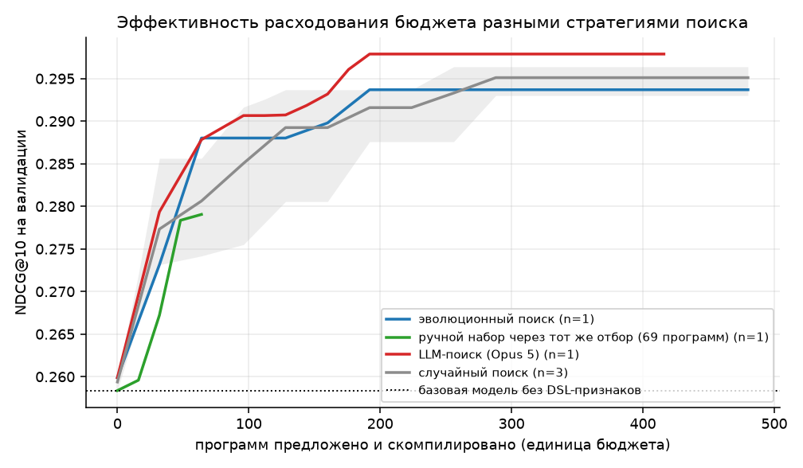
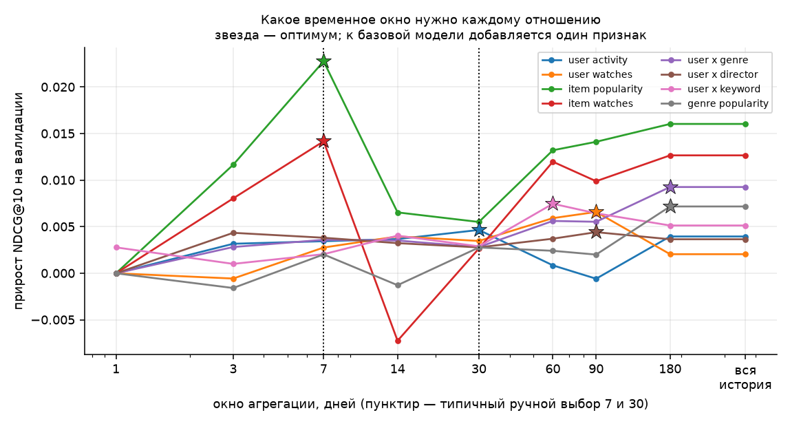
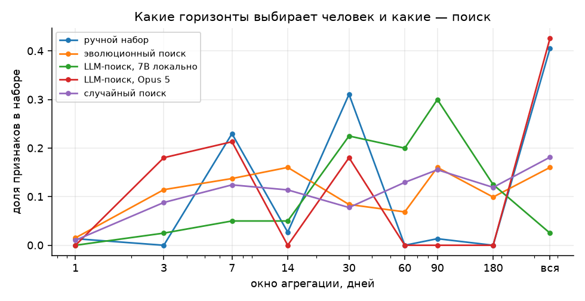
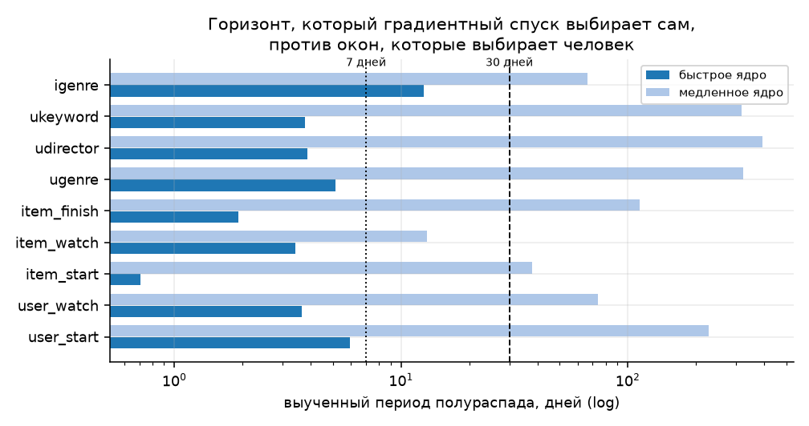
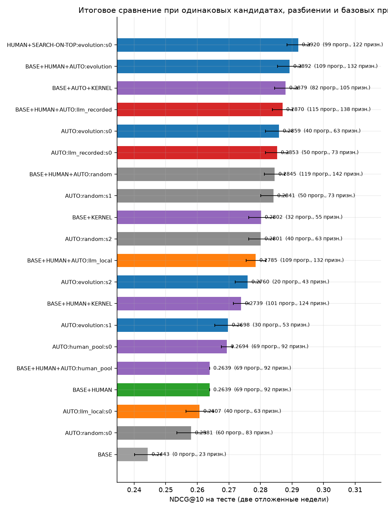
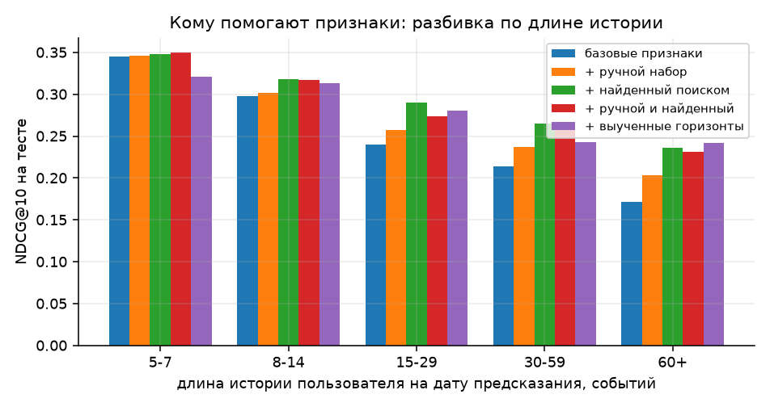
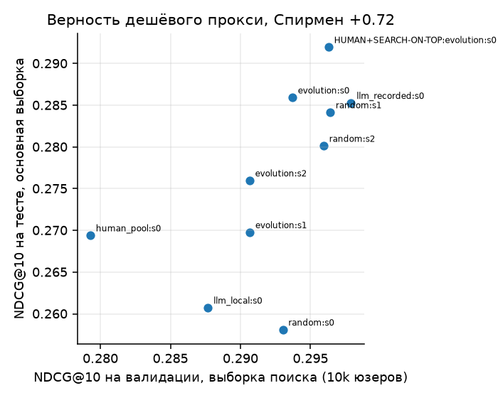

## Содержание

- [Коротко: что сделано и что получилось](#коротко-что-сделано-и-что-получилось)
- [О чём работа](#о-чём-работа)
- [Данные и постановка задачи](#данные-и-постановка-задачи)
  - [Разбиение по времени](#разбиение-по-времени)
  - [Выборка пользователей](#выборка-пользователей)
  - [Кандидаты](#кандидаты)
  - [Метрики](#метрики)
- [Почему в этом пайплайне нет утечек](#почему-в-этом-пайплайне-нет-утечек)
- [Исследовательская часть](#исследовательская-часть)
  - [Язык признаков](#язык-признаков)
  - [Ручной набор, с которым всё сравнивается](#ручной-набор-с-которым-всё-сравнивается)
  - [Протокол поиска с равным бюджетом](#протокол-поиска-с-равным-бюджетом)
  - [Обучаемые временные горизонты](#обучаемые-временные-горизонты)
- [Результаты](#результаты)
  - [Фолды и кандидаты](#фолды-и-кандидаты)
  - [Какое окно нужно каждому отношению](#какое-окно-нужно-каждому-отношению)
  - [Стратегии поиска при равном бюджете](#стратегии-поиска-при-равном-бюджете)
  - [Поиск, начинающий с ручного набора](#поиск-начинающий-с-ручного-набора)
  - [Итоговое сравнение на тесте (масштаб main)](#итоговое-сравнение-на-тесте-масштаб-main)
  - [Перенос на все 146 747 юзеров](#перенос-на-все-146-747-юзеров)
  - [Опорные точки без обучения ранкера](#опорные-точки-без-обучения-ранкера)
  - [Выученные временные горизонты (выборка 10000 юзеров)](#выученные-временные-горизонты-выборка-10000-юзеров)
  - [Переносится ли найденный набор на большую выборку](#переносится-ли-найденный-набор-на-большую-выборку)
  - [Нужен ли поиск, если можно посчитать всё подряд](#нужен-ли-поиск-если-можно-посчитать-всё-подряд)
  - [Вычислительные затраты](#вычислительные-затраты)
  - [Расширение языка: то, что плоская грамматика не выражает](#расширение-языка-то-что-плоская-грамматика-не-выражает)
  - [Кому помогают признаки: разбивка по длине истории](#кому-помогают-признаки-разбивка-по-длине-истории)
  - [Распределение выбранных горизонтов](#распределение-выбранных-горизонтов)
  - [Верность дешёвого прокси](#верность-дешёвого-прокси)
- [Рисунки](#рисунки)
- [Сравнение подходов](#сравнение-подходов)
  - [Что покупает LLM в цикле поиска](#что-покупает-llm-в-цикле-поиска)
  - [Сколько стоит одно деление шкалы](#сколько-стоит-одно-деление-шкалы)
  - [Итог на тесте](#итог-на-тесте)
  - [Переносится ли найденное на большую выборку](#переносится-ли-найденное-на-большую-выборку)
- [Что сработало и что нет](#что-сработало-и-что-нет)
  - [Структура датасета определяет, какие признаки вообще возможны](#структура-датасета-определяет-какие-признаки-вообще-возможны)
  - [Самый полезный признак — не величина, а её место в списке кандидатов](#самый-полезный-признак--не-величина-а-её-место-в-списке-кандидатов)
  - [Признаки одного пользователя бесполезны в ранжировании сами по себе](#признаки-одного-пользователя-бесполезны-в-ранжировании-сами-по-себе)
  - [Явные произведения признаков в основном избыточны](#явные-произведения-признаков-в-основном-избыточны)
  - [Поиск нашёл границы собственного языка](#поиск-нашёл-границы-собственного-языка)
  - [Кому именно помогают найденные признаки](#кому-именно-помогают-найденные-признаки)
  - [Насколько можно доверять поиску на дешёвой выборке](#насколько-можно-доверять-поиску-на-дешёвой-выборке)
  - [Нужен ли поиск, если можно посчитать всё подряд](#нужен-ли-поиск-если-можно-посчитать-всё-подряд)
  - [«Почему именно семь дней»](#почему-именно-семь-дней)
  - [Чего стоит LLM в цикле](#чего-стоит-llm-в-цикле)
- [Ограничения](#ограничения)
- [Воспроизведение](#воспроизведение)
- [Структура репозитория](#структура-репозитория)

## Коротко: что сделано и что получилось

Задача — еженедельное ранжирование контента в KION: для даты предсказания
отранжировать ~100 кандидатов на пользователя по тому, посмотрит ли он их в
следующие семь дней. Двухстадийная схема: четыре генератора кандидатов плюс
ранкер на LightGBM LambdaRank. Восемь недельных фолдов, пять на обучение, один
на валидацию, два отложенных на тест. Все числа ниже — на тесте, на выборке
40 000 пользователей, 7751 группа с позитивом.

**Главный результат: автоматический поиск признаков обходит ручной набор,
но лучше всего работает не вместо человека, а поверх него.**

| подход | признаков | test NDCG@10 | Δ к ручному набору |
|---|---|---|---|
| только популярность, без обучения | — | 0.2118 | |
| BASE: кандидаты и метаданные | 23 | 0.2443 | −0.0198 |
| **ручной набор, 69 программ** | 92 | **0.2639** | эталон |
| выученные горизонты, 32 программы | 55 | 0.2802 | +0.0164 |
| LLM-поиск, Opus 5 | 73 | 0.2853 | +0.0211 |
| эволюционный поиск, лучший сид | 63 | 0.2859 | +0.0222 |
| **поиск, стартующий с ручного набора** | 122 | **0.2920** | **+0.0281** |

Шесть вещей, которые стоит прочитать, даже если дальше читать не хочется.

**1. Признаки описаны языком, в котором утечка невозможна.** Признак — не код,
а JSON-программа; компилятор получает только события строго до даты
предсказания и проверяет это утверждением. Поэтому придумывание признаков можно
доверить машине, не проверяя каждую фичу руками. Утверждение подкреплено шестью
автотестами: отравление лога будущим на 433 признаках всех семейств, отказ
движка от будущих событий, граница окна на синтетике, детерминизм кандидатов,
разрушение метки и синтаксический аудит SQL-рендера каждой программы. Тесты
нашли три настоящих бага: неустойчивые тай-брейки в генераторах кандидатов,
ошибку в ко-просмотрах и потерю разрядов при суммировании длительностей.

**2. Сравнение стратегий сделано при строго одинаковом бюджете**, с двумя
контрольными плечами: ручной набор, прогнанный через тот же протокол отбора, и
систематическая сетка признаков вообще без поиска. Пространство — 109 728
атомарных программ и около 1.8·10¹⁰ с композициями, так что полный перебор
исключён.

**3. Измерен уровень шума, и половина «значимых» различий им объясняется.**
Контрольное плечо с **тем же самым** набором признаков, отличающимся только
порядком колонок, дало на тесте +0.0058 с интервалом, не содержащим нуля.
Поэтому в отчёте всё, что меньше этого уровня, считается отсутствующим,
независимо от доверительного интервала.

**4. Ответ на вопрос «почему именно семь дней» получен тремя независимыми
способами, и они сошлись.** Прямой свип окон: спросу на контент нужно 7 дней
(+0.0228, против +0.0055 на тридцати), а вкусу к жанру — 180 дней (+0.0093,
против +0.0028 на тридцати). Дискретный поиск сошёлся на тех же горизонтах.
Градиентный спуск по обучаемому затуханию дал период полураспада 0.6 дня для
спроса на объект и 688 дней для вкуса к жанру — при том что история в данных
длиной 163 дня, то есть «вкус не забывается вовсе». Ручной выбор из «7 или 30»
промахивается в обе стороны одновременно.

**5. Слабая LLM в цикле хуже, чем никакой.** Локальная модель на 7 млрд
параметров дала 0.2607 — **ниже ручного набора**: около половины её предложений
отсекает валидатор грамматики, и половина бюджета уходит впустую, а два
поколения из шести не дали ни одной валидной программы. Большая модель за 15
вызовов не нарушила грамматику ни разу. Выигрыш большой модели — не более
высокий потолок, а втрое меньше проверок до того же уровня.

**6. Насыщение поиска — сигнал расширить язык, а не бюджет.** Поиск вышел на
плато и пять блоков подряд не улучшал валидацию. Разбор показал две
конструкции, невыразимые в плоской грамматике: агрегат от агрегата и якорь по
атрибуту пользователя. Добавленные уже после окончания сравнения, они дали
+0.0092 поверх ручного набора, причём почти весь вклад пришёлся на одну простую
вещь — **спрос среди людей того же пола и достатка за последнюю неделю**.

# Автоматизация построения признаков для рекомендательного ранжирования

Отчёт по заданию T-Lab 2026, RecSys. Датасет — KION от МТС.

## О чём работа

Задание спрашивает, можно ли избавиться от ручного придумывания признаков в
рекомендательном ранжировании. Я отвечаю на этот вопрос в три шага.

Во-первых, собран воспроизводимый двухстадийный пайплайн: генераторы кандидатов
плюс ранкер на градиентном бустинге с содержательным ручным набором признаков.
Во-вторых, признаки описаны **типизированным языком программ (DSL)**, устроенным
так, что утечка из будущего в нём невозможна по построению, а не по результатам
ревью каждой фичи. Поэтому предлагать признаки можно доверить машине: языковая
модель порождает не код, а программу, которая проходит валидацию грамматики до
того, как что-либо будет вычислено. В-третьих, поиск по этому языку сравнивается
при **строго одинаковом бюджете** между четырьмя стратегиями — случайный поиск,
эволюционный поиск, локальная LLM на 7B параметров и большая LLM, — плюс два
контрольных подхода: ручной набор, прогнанный через тот же протокол отбора, и
систематическая сетка признаков вообще без поиска.

Отдельно проверяется буквальный вопрос из условия — «почему именно семь дней».
Вместо жёсткого окна берётся гладкое ядро `exp(-λ·возраст)`, а λ обучается
градиентным спуском. Выученный период полураспада можно прямо сравнить с теми
окнами, которые человек выбирает на глаз.

Главные выводы собраны в конце отчёта, в разделе «Что сработало и что нет».

## Данные и постановка задачи

KION содержит 5 476 251 просмотр за период с 13 марта по 22 августа 2021 года:
962 179 пользователей, 15 963 единицы контента, демография пользователей и
метаданные контента (жанры, страны, студии, режиссёры, актёры, ключевые слова,
год выпуска, возрастной рейтинг).

Из `watched_pct` сделана вложенная воронка типов событий, похожая на
показ → клик → покупку из условия задания:

| тип события | условие | доля событий |
|---|---|---|
| `start` | любое взаимодействие | 100% |
| `watch` | просмотрено ≥ 30% | ~51% |
| `finish` | просмотрено ≥ 90% | ~32% |

**Важное свойство датасета, которое меняет постановку.** В таблице
взаимодействий ровно одна строка на пару (пользователь, объект) — колонка
называется `last_watch_dt`. Я это проверил: среди пар (пользователь, объект) из
целевой недели **ни одна** не встречается в предшествующей истории этого
пользователя. То есть повторное потребление в KION невозможно в принципе.

Из этого следуют два вывода. Первый: «прямые связи» user–item, которые условие
задания подаёт как ценную группу признаков, здесь вырождены — любой такой
признак тождественно равен нулю на кандидатах. Вся персонализация обязана идти
через **косвенные связи** (пользователь → атрибут → объект). Второй: уже
просмотренные объекты можно и нужно выкидывать из списка кандидатов, потому что
они гарантированно отрицательные. При одном и том же размере
списка в 100 кандидатов это поднимает их recall с 0.3272 до 0.3351 — прибавка
скромная, всего 2.4% относительно, потому что ALS и ко-просмотры и так почти не
предлагают уже просмотренное. Ценность наблюдения в другом: оно говорит, что
целую группу признаков из условия задания здесь строить незачем.

### Разбиение по времени

Задача поставлена как еженедельное предсказание: для даты предсказания `T`
история — это всё строго до `T`, целевое окно — `[T, T+7)`, метка равна единице,
если пользователь посмотрел объект в целевом окне. Восемь дат идут подряд:

* обучение — 28 июня, 5, 12, 19, 26 июля;
* валидация — 2 августа;
* тест — 9 и 16 августа (две недели, чтобы хватило статистической мощности).

Каждый фолд считает свои признаки по своей истории, поэтому обучающие признаки
никогда не видят целевых окон валидации и теста. Признаки валидации видят
целевое окно обучения, но для них это прошлое — именно так работает продакшен.

### Выборка пользователей

Железо — ноутбук, поэтому пользователи сэмплируются, но **история каждого
взятого пользователя сохраняется целиком**, как требует условие. Правило отбора
намеренно не смотрит ни на что позже первой даты предсказания: берутся
пользователи, у которых к 28 июня 2021 было не меньше пяти событий. Таких
146 747. Результаты измеряются на выборке 40 000 пользователей, поиск признаков
ведётся на дешёвой выборке 10 000, а перенос проверяется на выборке 100 000.
Размеры подобраны так, чтобы самый широкий из сравниваемых наборов признаков
помещался в 30 ГБ памяти вместе с копией матрицы, которую делает LightGBM.

Статистики айтемов (популярность, конверсии, тренды) считаются по **всей**
популяции, а не по выборке: именно такая информация есть у живого сервиса.
Статистики пользователя считаются по его собственной истории.

### Кандидаты

Кандидаты строятся один раз, на всех 146 747 пользователей, и затем только
подмножествуются по пользователям. Благодаря этому все подходы и все масштабы
видят буквально одинаковые списки, и сравнение идёт честно. Четыре генератора:

* популярное за 14 дней, топ-150;
* ALS (implicit, 64 фактора, 15 итераций), топ-80 на пользователя;
* item-item ко-просмотры с нормировкой на популярность, топ-80 по восьми
  последним просмотренным объектам;
* популярное внутри трёх любимых жанров пользователя.

Списки сливаются взвешенной суммой обратных рангов (RRF) и обрезаются до 100
кандидатов на пользователя. Уже просмотренное выбрасывается.

### Метрики

Основная метрика — NDCG@10 внутри списка кандидатов: она изолирует качество
ранкера, потому что кандидаты у всех подходов одинаковые. Дополнительно
приводится **абсолютный** NDCG@10, в котором пользователь наказывается за
позитивы, не найденные стадией кандидатов, — это число ближе к тому, что увидит
продукт. Также считаются MAP@10, Recall@10, ROC-AUC и LogLoss.

Ранжирующие метрики считаются по группам, в которых есть хотя бы один позитив
среди кандидатов: без позитивов NDCG не определён. Ранкер (LambdaRank) на таких
группах всё равно получает нулевой градиент, поэтому они исключаются и из
обучения. Это стандартная практика для двухстадийных схем, но отмечу её прямо.

## Почему в этом пайплайне нет утечек

Это главный инженерный аргумент работы, поэтому он вынесен в отдельный раздел.

Признак в DSL — не код, а JSON-программа. Компилятор программ (`FoldEngine`)
получает на входе **только** события строго до даты предсказания, и проверяет
это утверждением в конструкторе. Временное окно реализовано как полуинтервал
`[T−w, T)`. Отсюда следует, что ни одна программа языка не может заглянуть в
будущее — свойство принадлежит движку, а не конкретной фиче. Именно это и даёт
право поручить придумывание признаков алгоритму или языковой модели: проверять
каждую сгенерированную фичу руками не нужно.

Утверждение подкреплено пятью автоматическими тестами (`tests/test_no_leakage.py`):

1. **Отравление лога будущим.** К событиям добавляются целевая неделя,
   продублированная с максимальными значениями `watched_pct` и `total_dur`, и
   синтетические события на 100 дней позже. **433 признака всех семейств
   языка** — ручные, из систематической сетки, случайные, вложенные,
   сегментные и с мягким окном — обязаны совпасть с чистым прогоном побитово.
2. **Движок отказывается от будущего.** Передача конструктору лога, который
   доходит до `T`, должна приводить к ошибке.
3. **Граница окна.** На синтетическом логе с ровно одним событием в день окно
   `w` обязано посчитать `w−1` событий: возраст 0 — это сама дата предсказания,
   она относится к целевому окну и в историю не попадает. Проверяется и то, что
   самое свежее видимое событие — вчерашнее.
4. **Кандидаты — функция прошлого.** Генерация кандидатов на отравленном логе
   должна дать тот же список. Этот тест нашёл реальную проблему: неустойчивые
   тай-брейки в сортировках генераторов и ошибку в ко-просмотрах, где «восемь
   последних объектов» брались по индексу, а не по времени. И то и другое
   исправлено.
5. **Разрушение метки.** После независимой перестановки меток внутри каждой
   группы модель на том же наборе признаков обязана работать на уровне
   случайного порядка. Получается NDCG@10 = 0.0464 против 0.0506 у случайного
   ранжирования, то есть сигнала не остаётся.

Шестой тест — синтаксический, а не поведенческий: каждая программа языка
рендерится в SQL (`dsl.to_sql`), и проверяется, что условие по времени в запросе
одностороннее. Побочный полезный эффект в том, что любой проверяющий может
прочитать сгенерированный признак как обычный запрос и убедиться в этом сам;
двенадцать самых полезных найденных признаков выписаны в
`reports/discovered_features.md`.

Отдельный тест (`tests/test_engine_equivalence.py`) сравнивает быстрый движок с
эталонной реализацией «в лоб» на 250 случайных программах. Быстрый движок
восстанавливает атрибутные агрегаты из разложимых компонент айтемного уровня
(это на порядок дешевле, чем джойнить миллионы событий), и тест следит, чтобы
оптимизация не превратилась в тихую ошибку. Он тоже нашёл реальный баг:
суммы длительностей в Float32 теряли разряды.

## Исследовательская часть

### Язык признаков

Признак записывается как JSON-программа. Атомарная программа — агрегат:

```json
{"kind":"agg","anchor":"attr","via":"genres","event":"watch",
 "window":30,"agg":"count","norm":"share_user","pool":"sum"}
```

Читается так: взять события пользователя за последние 30 дней, в которых
просмотрено не меньше 30% контента, оставить те, что относятся к объектам,
делящим жанр с кандидатом, посчитать их количество, поделить на общее число
событий пользователя за те же 30 дней, а если у кандидата несколько жанров —
сложить значения по жанрам.

Поля и их домены:

| поле | значения | смысл |
|---|---|---|
| `anchor` | `user`, `item`, `attr`, `attr_item` | по чему группируем |
| `via` | 9 атрибутов контента | через какой атрибут идёт косвенная связь |
| `event` | `start`, `watch`, `finish` | уровень воронки |
| `window` | 1, 3, 7, 14, 30, 60, 90, 180, вся история | горизонт |
| `agg` | 12 функций | count, nuniq_item/user/day, mean/max/std_pct, sum/mean_dur, recency, mean_age, trend |
| `norm` | нет, log1p, per_day, share_user, share_item, z_in_group, rank_in_group | нормировка |
| `pool` | max, sum, mean, min | свёртка по значениям атрибута у кандидата |

Два якоря отвечают за разные вещи. `attr` — это личная косвенная связь: история
самого пользователя, отфильтрованная по общему с кандидатом значению атрибута.
`attr_item` — поведение толпы внутри этого значения атрибута, то есть «насколько
сейчас горяч этот жанр». Отдельно стоит отметить `z_in_group` и `rank_in_group`:
они нормируют признак внутри списка кандидатов одного пользователя. Для
ранжирования это естественная операция, и, как покажут результаты, именно она
оказалась самой полезной.

Композиции: `ratio` считает `a / (b + 1)`, `mul` считает `a · b`.

Этим грамматика исчерпывается — именно по ней и идёт сравнение стратегий. Позже
язык расширяется тремя конструкциями (`decay` — мягкое окно с обучаемым
затуханием, `nested` — агрегат от агрегата, `segment` — якорь по атрибуту
пользователя), но все они появились **после** того, как сравнение было
проведено, и в нём не участвуют. Почему именно эти три — в разделе «Поиск нашёл
границы собственного языка».

Валидатор отбрасывает заведомо вырожденные комбинации: `nuniq_user` при
группировке по одному пользователю всегда равен единице, `nuniq_item` при
группировке по одному объекту — тоже; `per_day` и доли имеют смысл только для
счётных агрегатов; `share_user` требует якоря с пользователем, `share_item` — с
объектом.

**Размер пространства.** Валидных атомарных программ — 109 728. С композициями
получается около 1.8·10¹⁰. Исчерпывающий перебор невозможен даже близко, и это
главный аргумент за то, что поиск должен быть умным, а не полным.

### Ручной набор, с которым всё сравнивается

Сравнение честно ровно настолько, насколько силён baseline, поэтому его состав
приведён целиком — судите сами. 69 программ, написанных до того, как был
запущен хоть один поиск, и ни разу после этого не правленных:

| срез | состав |
|---|---|
| якорь | пользователь 22, объект 18, косвенная связь 19, толпа внутри атрибута 5, отношения 5 |
| окно | вся история 28, 30 дней 17, 7 дней 15, остальные (1, 14, 90) 4 |
| агрегат | count 43, mean/max_pct 5, nuniq_item/user/day 8, recency 3, trend 2, длительности 3 |
| событие | start 56, watch 6, finish 2 |
| атрибут | жанры 14, остальные восемь по 1–2 |
| нормировка | без неё 53, доля от активности 5, на день 4, внутри списка 2 |

Набор покрывает все группы признаков, которые перечисляет условие задания:
активность и глубина просмотра пользователя, популярность и конверсии объекта,
косвенные связи через все девять атрибутов контента, статистики толпы внутри
атрибута, отношения между уровнями воронки, тренды и давность.

Две вещи в этом составе стоит отметить заранее, потому что именно они окажутся
в центре результатов. Во-первых, окна взяты круглые — семь дней, тридцать,
вся история; троек, шестидесяток и ста восьмидесяти там нет, хотя язык их
допускает. Во-вторых, нормировка внутри списка кандидатов применена всего к
двум программам из 69. Ни то ни другое не сделано нарочно: так пишет признаки
человек, у которого есть ограниченное время и разумные привычки.

### Протокол поиска с равным бюджетом

Это ядро экспериментального сравнения. Все стратегии работают в одном и том же
цикле; различается только то, как предлагаются программы.

**Единица бюджета — одна новая, скомпилированная и проэкранированная
программа.** Поколение устроено так:

1. стратегия предлагает 32 программы, которых ещё не пробовали;
2. программы компилируются (стоимость замеряется);
3. **экранирование**: обучается одна прокси-модель на «текущий набор + 32 новых»,
   и для каждой новой программы читается её gain по сплитам;
4. берутся 10 лучших по gain, обучается ещё одна прокси-модель, и блок
   принимается, только если NDCG@10 на валидации вырос.

Поколений 15, то есть бюджет — 480 программ и ровно 30 обучений прокси-модели у
каждой стратегии. Прокси-модель одна и та же: LightGBM LambdaRank, lr 0.12,
31 лист, до 300 деревьев с ранней остановкой. Тестовые фолды внутри поиска не
читаются вообще.

Двухступенчатая схема «дешёвое экранирование, затем точная проверка» — это то,
как устроены промышленные системы автоматического построения признаков. Она же
делает бюджет сопоставимым: стратегия не может выиграть за счёт того, что ей
дали больше обучений.

Стратегии:

* **случайный поиск** — равномерная выборка из грамматики. Неинтересный, но
  обязательный контроль: без него нельзя утверждать, что LLM что-то добавляет.
* **эволюционный поиск** — мутации и скрещивание 12 программ с наибольшим gain,
  с 15% случайных вливаний для разнообразия.
* **LLM-поиск, Qwen2.5-Coder 7B** — полностью автоматический, модель работает
  локально на CPU. Нужен, чтобы показать, что цикл замыкается без человека.
* **LLM-поиск, Opus 5** — та же схема, но предложителем выступает большая
  модель. Все промпты и ответы лежат в репозитории дословно, прогон
  воспроизводится из них командой без доступа к API.
* **ручной набор через тот же протокол** — контроль на справедливость. Поиск
  имеет право подстраиваться под валидацию, а ручной набор я писал вслепую.
  Поэтому 69 ручных программ прогоняются через точно такой же цикл принятия
  блоков: если преимущество поиска объясняется только доступом к валидации,
  этот контроль его догонит.
* **систематическая сетка, без поиска** — 480 программ, перечисленных по тем же
  отношениям, что придумал бы человек, со всеми окнами и несколькими агрегатами,
  отданных модели целиком. Самая глупая автоматизация, какая может работать.
  Нужна, чтобы ответить на вопрос «а зачем вообще поиск, если можно посчитать
  всё и дать бустингу разобраться».

Что видит предложитель на каждом шаге: грамматику языка, описание домена,
принятый набор, 18 лучших программ с их gain, программы с нулевым gain
(«так больше не предлагай») и текущий NDCG@10 на валидации. Больше ничего —
в частности, никакой информации с тестовых фолдов.

### Обучаемые временные горизонты

Ручной признак фиксирует окно: «покупки за последние 7 дней». Семёрка — догадка.
Чтобы снять догадку, жёсткое окно заменяется гладким ядром: вклад события
возрастом `d` дней равен `exp(−λ·d)`, а λ — обучаемый параметр.

Всё раскладывается в произведение разреженных матриц. Для отношения `r` суточные
счётчики событий живут в небольшой матрице `S_r` (пользователь × день, объект ×
день, (пользователь, значение атрибута) × день), а разреженное назначение `P_r`
сопоставляет строке-кандидату те ключи, на которые она опирается. Признак равен

```
f_r = P_r · (S_r · exp(−λ_r · d))
```

Это дёшево, точно и дифференцируемо по λ. Девять отношений, по два ядра на
каждое (быстрое и медленное), поверх — маленький MLP, обучение листовым
софтмаксом внутри списка кандидатов. Выученный период полураспада `ln2/λ`
сравнивается напрямую с окнами, которые ставит человек.

Дальше выученные λ подставляются обратно: признаки-ядра отдаются тому же
бустингу вместо и вместе с ручными окнами. Так проверяется не только то, какой
горизонт «хочет» каждое отношение, но и приносит ли это пользу на практике.

Независимо от ядер сделан прямой свип: для каждого из восьми отношений один и
тот же счётный признак добавляется к базовой модели со всеми девятью окнами по
одному, и записывается прирост на валидации. Это эмпирический ответ на вопрос
«почему именно семь дней» в самой наглядной форме.

## Результаты

### Фолды и кандидаты

| дата предсказания | роль | ранжируемых юзеров | достижимых позитивов | попало в кандидаты | recall кандидатов | групп с позитивом | строк |
|---|---|---|---|---|---|---|---|
| 2021-06-28 | train | 146 747 | 145 121 | 71 414 | 0.492 | 39 647 | 3 964 700 |
| 2021-07-05 | train | 146 747 | 110 154 | 41 602 | 0.378 | 25 394 | 2 539 400 |
| 2021-07-12 | train | 146 747 | 101 222 | 37 662 | 0.372 | 22 793 | 2 279 300 |
| 2021-07-19 | train | 146 747 | 91 814 | 34 359 | 0.374 | 20 488 | 2 048 800 |
| 2021-07-26 | train | 146 747 | 89 000 | 33 076 | 0.372 | 19 978 | 1 997 800 |
| 2021-08-02 | val | 146 747 | 83 036 | 31 239 | 0.376 | 18 524 | 1 852 400 |
| 2021-08-09 | test | 146 747 | 80 275 | 27 534 | 0.343 | 16 854 | 1 685 400 |
| 2021-08-16 | test | 146 747 | 79 243 | 28 879 | 0.364 | 17 325 | 1 732 500 |


### Какое окно нужно каждому отношению

| отношение | лучшее окно, дней | прирост NDCG@10 | прирост при 7 днях | прирост при 30 днях | что теряет ручной выбор |
|---|---|---|---|---|---|
| user activity | 30 | +0.0047 | +0.0034 | +0.0047 | +0.0000 |
| user watches | 90 | +0.0066 | +0.0028 | +0.0035 | +0.0031 |
| item popularity | 7 | +0.0228 | +0.0228 | +0.0055 | +0.0000 |
| item watches | 7 | +0.0142 | +0.0142 | +0.0027 | +0.0000 |
| user x genre | 180 | +0.0093 | +0.0036 | +0.0028 | +0.0057 |
| user x director | 90 | +0.0044 | +0.0038 | +0.0028 | +0.0006 |
| user x keyword | 60 | +0.0075 | +0.0021 | +0.0029 | +0.0046 |
| genre popularity | 180 | +0.0072 | +0.0020 | +0.0028 | +0.0044 |

Базовая модель без DSL-признаков: NDCG@10 = 0.2584 на валидации.


### Стратегии поиска при равном бюджете

| стратегия | сидов | программ | val@128 | val@256 | val финал | признаков | мин. поиска | вызовов LLM | отбраковано грамматикой |
|---|---|---|---|---|---|---|---|---|---|
| эволюционный поиск | 3 | 480 | 0.2881 | 0.2917 | 0.2917 ± 0.0014 | 30 | 11.5 | — | — |
| ручной набор, тот же протокол отбора | 1 | 69 | 0.2793 | 0.2793 | 0.2793 | 69 | 0.8 | — | — |
| LLM-поиск, Qwen2.5-Coder 7B (локально) | 1 | 82 | 0.2877 | 0.2877 | 0.2877 | 40 | 44.3 | 12 | 65% |
| LLM-поиск, Opus 5 | 1 | 421 | 0.2907 | 0.2979 | 0.2979 | 50 | 14.0 | 15 | 0% |
| случайный поиск | 3 | 480 | 0.2893 | 0.2933 | 0.2951 ± 0.0015 | 50 | 10.9 | — | — |

Бюджет у всех стратегий одинаковый: 15 поколений по 32 программы и ровно 30 обучений прокси-модели. Ручной набор прогнан через тот же протокол, но у него всего 69 программ, поэтому его строка короче.


### Поиск, начинающий с ручного набора

| стратегия | сид | val с ручным набором | val после поиска | прирост | добавлено признаков | программ |
|---|---|---|---|---|---|---|
| эволюционный поиск | 0 | 0.28457737401649075 | 0.2963 | +0.0117 | 30 | 480 |


### Итоговое сравнение на тесте (масштаб main)

| набор | прогр. | призн. | val NDCG@10 | test NDCG@10 | test NDCG@10 абс. | MAP@10 | Recall@10 | AUC | Δ к BASE+HUMAN, 95% ДИ | доля gain у DSL-призн. | сек. призн./обуч. |
|---|---|---|---|---|---|---|---|---|---|---|---|
| HUMAN+SEARCH-ON-TOP:evolution:s0 | 99 | 122 | 0.3056 | 0.2920 | 0.1417 | 0.2155 | 0.4659 | 0.7911 | +0.0281 [+0.0245; +0.0317] | 0.81 | 114/99 |
| BASE+HUMAN+AUTO:evolution | 109 | 132 | 0.3040 | 0.2892 | 0.1401 | 0.2124 | 0.4656 | 0.7907 | +0.0252 [+0.0214; +0.0288] | 0.82 | 98/127 |
| BASE+AUTO+KERNEL | 82 | 105 | 0.3052 | 0.2879 | 0.1396 | 0.2108 | 0.4653 | 0.7914 | +0.0239 [+0.0204; +0.0276] | 0.82 | 191/87 |
| BASE+HUMAN+AUTO:llm_recorded | 115 | 138 | 0.3013 | 0.2870 | 0.1393 | 0.2106 | 0.4617 | 0.7909 | +0.0229 [+0.0197; +0.0261] | 0.83 | 159/88 |
| AUTO:evolution:s0 | 40 | 63 | 0.3006 | 0.2859 | 0.1388 | 0.2106 | 0.4572 | 0.7813 | +0.0222 [+0.0179; +0.0263] | 0.77 | 33/82 |
| AUTO:llm_recorded:s0 | 50 | 73 | 0.3048 | 0.2853 | 0.1383 | 0.2092 | 0.4592 | 0.7897 | +0.0211 [+0.0174; +0.0246] | 0.82 | 82/82 |
| BASE+HUMAN+AUTO:random | 119 | 142 | 0.3012 | 0.2845 | 0.1383 | 0.2080 | 0.4610 | 0.7897 | +0.0204 [+0.0171; +0.0236] | 0.83 | 197/161 |
| AUTO:random:s1 | 50 | 73 | 0.3038 | 0.2841 | 0.1377 | 0.2092 | 0.4537 | 0.7838 | +0.0197 [+0.0157; +0.0236] | 0.59 | 106/55 |
| BASE+KERNEL | 32 | 55 | 0.2983 | 0.2802 | 0.1359 | 0.2038 | 0.4550 | 0.7868 | +0.0164 [+0.0125; +0.0205] | 0.77 | 113/68 |
| AUTO:random:s2 | 40 | 63 | 0.3015 | 0.2801 | 0.1354 | 0.2055 | 0.4487 | 0.7832 | +0.0165 [+0.0127; +0.0207] | 0.73 | 77/67 |
| BASE+HUMAN+AUTO:llm_local | 109 | 132 | 0.2870 | 0.2785 | 0.1352 | 0.2023 | 0.4536 | 0.7879 | +0.0140 [+0.0110; +0.0172] | 0.82 | 250/112 |
| AUTO:evolution:s2 | 20 | 43 | 0.2970 | 0.2760 | 0.1337 | 0.2038 | 0.4380 | 0.7794 | +0.0118 [+0.0078; +0.0156] | 0.68 | 11/41 |
| BASE+HUMAN+KERNEL | 101 | 124 | 0.2884 | 0.2739 | 0.1329 | 0.1959 | 0.4587 | 0.7894 | +0.0102 [+0.0077; +0.0128] | 0.82 | 56/100 |
| AUTO:evolution:s1 | 30 | 53 | 0.3013 | 0.2698 | 0.1308 | 0.1948 | 0.4415 | 0.7788 | +0.0059 [+0.0017; +0.0100] | 0.43 | 23/59 |
| AUTO:human_pool:s0 | 69 | 92 | 0.2874 | 0.2694 | 0.1313 | 0.1931 | 0.4496 | 0.7867 | +0.0058 [+0.0040; +0.0076] | 0.81 | 42/107 |
| BASE+HUMAN | 69 | 92 | 0.2876 | 0.2639 | 0.1284 | 0.1875 | 0.4457 | 0.7860 | — (эталон) | 0.81 | 44/81 |
| BASE+HUMAN+AUTO:human_pool | 69 | 92 | 0.2876 | 0.2639 | 0.1284 | 0.1875 | 0.4457 | 0.7860 | +0.0000 [+0.0000; +0.0000] | 0.81 | 56/90 |
| AUTO:llm_local:s0 | 40 | 63 | 0.2995 | 0.2607 | 0.1268 | 0.1890 | 0.4235 | 0.7700 | -0.0036 [-0.0079; +0.0007] | 0.35 | 163/67 |
| AUTO:random:s0 | 60 | 83 | 0.2629 | 0.2581 | 0.1255 | 0.1878 | 0.4205 | 0.7592 | -0.0051 [-0.0096; -0.0006] | 0.59 | 65/19 |
| BASE | 0 | 23 | 0.2671 | 0.2443 | 0.1185 | 0.1800 | 0.3868 | 0.7510 | -0.0198 [-0.0240; -0.0156] | 0.00 | 0/27 |


### Перенос на все 146 747 юзеров

| набор | прогр. | призн. | val NDCG@10 | test NDCG@10 | test NDCG@10 абс. | MAP@10 | Recall@10 | AUC | Δ к BASE+HUMAN, 95% ДИ | доля gain у DSL-призн. | сек. призн./обуч. |
|---|---|---|---|---|---|---|---|---|---|---|---|
| AUTO:evolution:s0 | 40 | 63 | 0.3022 | 0.2864 | 0.1393 | 0.2108 | 0.4572 | 0.7813 | — (эталон) | 0.78 | 48/107 |
| BASE+HUMAN | 69 | 92 | 0.2943 | 0.2664 | 0.1304 | 0.1896 | 0.4475 | 0.7857 | — (эталон) | 0.80 | 74/143 |
| AUTO:human_pool:s0 | 69 | 92 | 0.2922 | 0.2632 | 0.1287 | 0.1869 | 0.4428 | 0.7848 | — (эталон) | 0.80 | 68/181 |
| BASE | 0 | 23 | 0.2694 | 0.2454 | 0.1196 | 0.1816 | 0.3847 | 0.7488 | — (эталон) | 0.00 | 0/60 |


### Опорные точки без обучения ранкера

| правило | что это | test NDCG@10 | test NDCG@10 абс. | Recall@10 |
|---|---|---|---|---|
| rrf | rank fusion of the four generators | 0.2273 | 0.1098 | 0.3696 |
| als | ALS score alone | 0.1194 | 0.0570 | 0.2041 |
| popularity | 14-day popularity alone | 0.2118 | 0.1030 | 0.3676 |


### Выученные временные горизонты (выборка 10000 юзеров)

| отношение | быстрое ядро, дней полураспада | медленное ядро, дней |
|---|---|---|
| активность пользователя | 6.53 | 816.4 |
| глубокие просмотры пользователя | 1.75 | 494.81 |
| спрос на объект | 0.63 | 19.2 |
| глубокие просмотры объекта | 1.41 | 18.94 |
| досмотры объекта | 1.88 | 240.99 |
| вкус к жанру | 9.03 | 688.46 |
| вкус к режиссёру | 1.9 | 64.52 |
| вкус к теме | 2.82 | 210.76 |
| спрос на жанр у всех | 48.54 | 170.78 |


#### Ядра внутри градиентного бустинга (та же выборка 10000 юзеров, не сравнивать напрямую с основной таблицей)

| набор | признаков | val NDCG@10 | test NDCG@10 | test абс. |
|---|---|---|---|---|
| BASE | 23 | 0.2609 | 0.2502 | 0.1204 |
| BASE+KERNEL | 41 | 0.2912 | 0.2744 | 0.1318 |
| BASE+HUMAN | 92 | 0.2766 | 0.2647 | 0.1275 |
| BASE+HUMAN+KERNEL | 110 | 0.2761 | 0.2694 | 0.1299 |

Модель только на ядрах, без бустинга: test NDCG@10 = 0.2516.


### Переносится ли найденный набор на большую выборку

| набор | 40 000 (основная) | 70 000 юзеров | 100 000 юзеров |
|---|---|---|---|
| BASE | 0.2443 | 0.2454 | 0.2459 |
| BASE+HUMAN | 0.2639 | 0.2664 | 0.2709 |
| AUTO:evolution:s0 | 0.2859 | 0.2864 | 0.2809 |
| AUTO:human_pool:s0 | 0.2694 | 0.2632 | 0.2690 |

Выборки вложены не полностью, поэтому колонки сравнивать между собой нужно только внутри одной строки относительно ручного набора. Полный набор из 16 плеч на 70 000 и 100 000 не поместился в память (процесс доходил до 25 ГБ), поэтому здесь только четыре ключевых: база, ручной набор, лучший найденный и контроль на шум.


### Нужен ли поиск, если можно посчитать всё подряд

| набор | прогр. | призн. | val NDCG@10 | test NDCG@10 | призн., с |
|---|---|---|---|---|---|
| BASE | 0 | 23 | 0.2609 | 0.2502 | 0 |
| BASE+HUMAN | 69 | 92 | 0.2766 | 0.2647 | 13 |
| BASE+GRID | 480 | 503 | 0.2888 | 0.2683 | 157 |

Измерено на поисковой выборке 10000 пользователей, где сетка помещается по времени и памяти. Сетка содержит те же 480 программ, что составляют бюджет одной стратегии поиска, но перечисленные систематически, без отбора.


### Вычислительные затраты

| подход | прогр. | призн. | поиск, мин | программ оценено | вызовов LLM / ток. | призн., с | обучение, с | деревьев |
|---|---|---|---|---|---|---|---|---|
| ручной набор | 69 | 92 | — | — | — | 44 | 81 | 300 |
| эволюционный поиск (сид 0) | 40 | 63 | 8.7 | 480 | — | 33 | 82 | 350 |
| эволюционный поиск (сид 1) | 30 | 53 | 21.5 | 480 | — | 23 | 59 | 287 |
| эволюционный поиск (сид 2) | 20 | 43 | 4.2 | 480 | — | 11 | 41 | 181 |
| ручной набор, тот же протокол отбора (сид 0) | 69 | 92 | 0.8 | 69 | — | 42 | 107 | 438 |
| LLM-поиск, Qwen2.5-Coder 7B (локально) (сид 0) | 40 | 63 | 44.3 | 82 | 12/18093 | 163 | 67 | 277 |
| LLM-поиск, Opus 5 (сид 0) | 50 | 73 | 14.0 | 421 | 15/— | 82 | 82 | 301 |
| случайный поиск (сид 0) | 60 | 83 | 9.8 | 480 | — | 65 | 19 | 3 |
| случайный поиск (сид 1) | 50 | 73 | 15.3 | 480 | — | 106 | 55 | 163 |
| случайный поиск (сид 2) | 40 | 63 | 7.5 | 480 | — | 77 | 67 | 282 |
| HUMAN+SEARCH-ON-TOP:evolution:s0 (сид 0) | 99 | 122 | — | — | — | 114 | 99 | 290 |
| BASE+HUMAN+AUTO:evolution | 109 | 132 | — | — | — | 98 | 127 | 368 |
| BASE+HUMAN+AUTO:human_pool | 69 | 92 | — | — | — | 56 | 90 | 300 |
| BASE+HUMAN+AUTO:llm_local | 109 | 132 | — | — | — | 250 | 112 | 202 |
| BASE+HUMAN+AUTO:llm_recorded | 115 | 138 | — | — | — | 159 | 88 | 191 |
| BASE+HUMAN+AUTO:random | 119 | 142 | — | — | — | 197 | 161 | 434 |
| BASE+KERNEL | 32 | 55 | — | — | — | 113 | 68 | 316 |
| BASE+HUMAN+KERNEL | 101 | 124 | — | — | — | 56 | 100 | 298 |
| BASE+AUTO+KERNEL | 82 | 105 | — | — | — | 191 | 87 | 265 |

Счёт признаков и обучение измерены на основной выборке, поиск — на дешёвой выборке 10 000 пользователей. Время счёта признаков — это и есть стоимость подхода в продакшене: его платят на каждом перестроении витрины.


### Расширение языка: то, что плоская грамматика не выражает

Добавлено 62 программ двух семейств — агрегат от агрегата («популярнее ли этот объект того, что пользователь обычно смотрит») и якорь по сегменту пользователя («популярно среди похожих по демографии»).

| набор | прогр. | призн. | val NDCG@10 | test NDCG@10 | доля gain у новых семейств |
|---|---|---|---|---|---|
| BASE+HUMAN | 69 | 92 | 0.2876 | 0.2639 | 0.00 |
| BASE+HUMAN+EXT | 131 | 154 | 0.2935 | 0.2730 | 0.36 |
| BASE+AUTO | 50 | 73 | 0.3048 | 0.2853 | 0.00 |
| BASE+AUTO+EXT | 112 | 135 | 0.3070 | 0.2905 | 0.19 |
| BASE+HUMAN+AUTO | 115 | 138 | 0.3013 | 0.2870 | 0.00 |
| BASE+HUMAN+AUTO+EXT | 177 | 200 | 0.3045 | 0.2896 | 0.18 |

| сравнение | Δ NDCG@10 | 95% ДИ | доля побед |
|---|---|---|---|
| BASE+HUMAN+EXT vs BASE+HUMAN | +0.0092 | [+0.0070; +0.0115] | 1.000 |
| BASE+AUTO+EXT vs BASE+AUTO | +0.0055 | [+0.0033; +0.0077] | 1.000 |
| BASE+HUMAN+AUTO+EXT vs BASE+HUMAN+AUTO | +0.0030 | [+0.0009; +0.0053] | 0.997 |


#### Самые полезные программы новых семейств

| признак | вклад по сплитам |
|---|---|
| seg_sex_sta_w7_count_z_in_group | 219 970 |
| seg_inco_sta_w7_count_z_in_group | 147 133 |
| seg_sex_sta_w7_nuniq_user_z_in_group | 33 757 |
| nest_item_sta_all_mean_age_mean_sta_all_diff | 23 420 |
| seg_age_sta_w7_count_z_in_group | 20 331 |
| nest_item_sta_w7_count_log1p_mean_sta_w30_diff | 16 882 |
| seg_sex_sta_w14_trend | 14 499 |
| nest_item_sta_w7_count_log1p_mean_sta_all_diff | 9 392 |


### Кому помогают признаки: разбивка по длине истории

| набор | 5-7 событий | 8-14 событий | 15-29 событий | 30-59 событий | 60+ событий |
|---|---|---|---|---|---|
| базовые признаки | 0.3447 | 0.2980 | 0.2400 | 0.2135 | 0.1712 |
| + ручной набор | 0.3462 | 0.3013 | 0.2570 | 0.2372 | 0.2036 |
| + найденный поиском | 0.3481 | 0.3078 | 0.2822 | 0.2596 | 0.2487 |
| + ручной и найденный | 0.3500 | 0.3167 | 0.2742 | 0.2629 | 0.2309 |
| + выученные горизонты | 0.3210 | 0.3135 | 0.2801 | 0.2424 | 0.2418 |

Размеры групп: 5-7 — 192, 8-14 — 566, 15-29 — 615, 30-59 — 411, 60+ — 151.


### Распределение выбранных горизонтов

| набор | 1 | 3 | 7 | 14 | 30 | 60 | 90 | 180 | вся история |
|---|---|---|---|---|---|---|---|---|---|
| ручной набор | 1 | 0 | 17 | 2 | 23 | 0 | 1 | 0 | 30 |
| evolution | 2 | 1 | 6 | 0 | 2 | 4 | 6 | 3 | 3 |
| human_pool | 1 | 0 | 17 | 2 | 23 | 0 | 1 | 0 | 30 |
| llm_local | 0 | 1 | 2 | 2 | 9 | 8 | 12 | 5 | 1 |
| llm_recorded | 0 | 11 | 13 | 0 | 11 | 0 | 0 | 0 | 26 |
| random | 0 | 5 | 5 | 3 | 4 | 9 | 9 | 4 | 9 |


### Верность дешёвого прокси

Корреляция Спирмена между NDCG@10 на валидации выборки поиска (10 000 юзеров) и NDCG@10 на тесте основной выборки по 10 найденным наборам: **+0.72** (p = 0.019).


## Рисунки



*Рост качества на валидации по мере расходования бюджета. Полоса — разброс по сидам.*



*Прирост от одного счётного признака при разных окнах, по отношениям. Звезда — оптимум.*



*Распределение выбранных горизонтов: ручной набор против найденных поиском.*



*Периоды полураспада, выученные градиентным спуском, против окон 7 и 30 дней.*



*Итоговое сравнение на двух отложенных неделях. Усы — 95% доверительный интервал парного бутстрэпа относительно ручного набора.*



*NDCG@10 в разбивке по длине истории пользователя.*



*Насколько валидация на выборке поиска предсказывает тест на основной выборке.*

## Сравнение подходов

### Что покупает LLM в цикле поиска

На валидации, при одинаковом бюджете в 480 предложенных программ и ровно 30
обучений прокси-модели, картина такая: LLM-поиск 0.2979, случайный поиск
0.2951 ± 0.0016 по трём сидам, эволюционный 0.2917 ± 0.0014 по трём сидам,
ручной набор через тот же протокол отбора 0.2793, базовая модель 0.2584.

Отсюда два разных утверждения, и их важно не путать.

**По финальному значению преимущество LLM невелико.** Разница с лучшим
случайным прогоном — порядка одной-двух стандартных ошибок разброса по сидам.
С одним прогоном большой модели утверждать, что она даёт более высокий потолок,
нельзя, и я этого не утверждаю.

**По скорости разрыв заметный.** Уровня, которого случайный поиск достигает
примерно к 290 предложенным программам, плечо с большой моделью достигает
примерно к 128 — втрое дешевле по числу вычисленных и проверенных признаков.
Своего максимума оно достигает к 190 программам и дальше не растёт,
израсходовав в итоге даже меньше бюджета, чем остальные (421 программа вместо
480, из-за дублей с уже опробованными).

Если переводить это в деньги: на реальном датасете один цикл «посчитать признак
и проверить его» стоит минуты процессорного времени, а вызов модели — центы.
Экономия втрое по числу проверок окупает стоимость модели с запасом. Но
рассчитывать, что модель найдёт принципиально недостижимое для перебора, по
этим данным оснований нет.

**Контроль на справедливость сработал.** Поиск имеет право подстраиваться под
валидацию, а ручной набор писался вслепую, и это могло бы объяснить весь
разрыв. Чтобы это проверить, 69 ручных программ прогнаны через точно такой же
цикл принятия блоков. Все три блока приняты, итог 0.2793 — доступ к валидации
ручному набору не дал ничего. Разрыв объясняется содержанием найденных
признаков, а не процедурой отбора.

### Сколько стоит одно деление шкалы

Прежде чем сравнивать подходы на тесте, нужно знать, какая разница вообще
что-то значит. Парный бутстрэп по пользователям меряет разброс выборки
пользователей, но **не меряет разброс обучения модели**, а он здесь есть:
LightGBM сэмплирует признаки и строки, и результат зависит в том числе от
порядка колонок в матрице.

Это вскрылось случайно. Контрольное плечо «ручной набор через тот же протокол
отбора» приняло все 69 программ, то есть его набор признаков **совпадает** с
ручным — отличается только порядок, в котором программы попали в матрицу. На
тесте оно дало +0.0058 с интервалом [+0.0040; +0.0076], который уверенно не
содержит нуля. Бутстрэп объявил значимым эффект, которого не существует.

Поэтому уровень шума измерен отдельно: ручной набор обучен четырьмя разными
сидами бустинга на одних и тех же признаках.

| сид | test NDCG@10 | AUC |
|---|---|---|
| 0 | 0.2656 | 0.7865 |
| 1 | 0.2640 | 0.7856 |
| 2 | 0.2667 | 0.7866 |
| 3 | 0.2659 | 0.7864 |

Размах 0.0027, стандартное отклонение 0.0010. И самое важное: из шести попарных
сравнений между этими четырьмя моделями **бутстрэп назвал значимыми три** — при
том что набор признаков во всех четырёх идентичен. Например, сиды 1 и 2
отличаются на +0.0031 с интервалом [+0.0015; +0.0047].

Итого два источника шума, не связанных с качеством признаков: смена сида
бустинга даёт до 0.003, перестановка колонок — до 0.006. **За рабочий порог в
этом отчёте взят больший из них: всё, что меньше 0.006, считается
отсутствующим**, независимо от того, что показывает доверительный интервал.

Отсюда же практическая рекомендация для любой похожей работы: доверительный
интервал по пользователям — необходимое, но недостаточное условие. Без контроля
на повторный запуск той же модели примерно половину «значимых» улучшений можно
получить из воздуха.

### Итог на тесте

Полная таблица — в разделе результатов. Коротко, с поправкой на уровень шума,
относительно ручного набора:

| подход | Δ NDCG@10 | как читать |
|---|---|---|
| ручной набор + поиск поверх него | +0.0281 | надёжно |
| ручной + найденный, объединение | +0.0252 | надёжно |
| найденный + выученные горизонты | +0.0239 | надёжно |
| эволюционный поиск, лучший сид | +0.0222 | надёжно |
| LLM-поиск, Opus 5 | +0.0211 | надёжно |
| только выученные горизонты, 55 признаков | +0.0164 | надёжно |
| эволюционный поиск, худший сид | +0.0059 | на уровне шума |
| **тот же ручной набор, другой порядок колонок** | **+0.0058** | **это и есть шум** |
| локальная модель 7B | −0.0036 | хуже человека |
| случайный поиск, худший сид | −0.0051 | хуже человека |

Четыре вывода.

**Автоматический поиск обходит человека, и уверенно.** Лучшие найденные наборы
дают прирост в три-четыре раза больше уровня шума, причём признаков в них
меньше: 63–73 программы против 69 ручных, а у плеча с выученными горизонтами
вообще 32.

**Но лучший результат — не замена человека, а дополнение к нему.** Поиск,
стартующий с ручного набора, даёт +0.0281 — больше, чем любой набор по
отдельности. Человеческие и найденные признаки несут разную информацию:
человек хорошо покрывает ширину (все девять атрибутов, вся воронка), поиск
хорошо находит правильную форму и горизонт для немногих самых сильных сигналов.

**Слабая модель в цикле хуже, чем никакой.** Локальная семимиллиардная модель
дала результат ниже ручного набора. Причина не в том, что её идеи плохи, а в
том, что около половины её предложений отсеивает валидатор грамматики, и
половина бюджета уходит впустую. Большая модель за те же 15 вызовов не
нарушила грамматику ни разу.

**Случайный поиск работает, но на него нельзя положиться с одной попытки.**
Три сида дали на тесте 0.2581, 0.2841 и 0.2801: разброс 0.026 — вчетверо больше
уровня шума. Худший сид оказался хуже человека, два других — заметно лучше. При
этом на валидации поисковой выборки этот же худший сид выглядел нормально
(0.2930), то есть провал виден только после переноса на большую выборку.

### Переносится ли найденное на большую выборку

Поиск признаков вёлся на дешёвой выборке 10 000 пользователей, и условие
задания прямо предупреждает, что такие результаты могут не обобщиться. Проверка
сделана на трёх масштабах: 40 000 (основной), 70 000 и 100 000 пользователей.

| набор | 40k | 70k | 100k |
|---|---|---|---|
| BASE | 0.2443 | 0.2454 | 0.2459 |
| ручной набор | 0.2639 | 0.2664 | 0.2709 |
| найденный поиском | 0.2859 | 0.2864 | 0.2809 |
| контроль на шум | 0.2694 | 0.2632 | 0.2690 |
| **преимущество поиска** | **+0.0222** | **+0.0200** | **+0.0100** |

Преимущество сохраняется на всех трёх масштабах и везде остаётся выше уровня
шума. Но интереснее не это, а **что именно меняется с ростом выборки**.

Найденный набор почти не реагирует: 0.2859, 0.2864, 0.2809 — он фактически на
своём потолке уже при сорока тысячах. А ручной растёт монотонно: 0.2639, 0.2664,
0.2709. То есть лишние данные достаются в основном ручным признакам.

Объяснение простое и проверяемое по составу наборов. Ручной набор широкий и
редкий: 69 программ размазаны по всем девяти атрибутам контента, по всей
воронке и по всем горизонтам, и многим из них просто не хватает данных —
признак «сколько раз пользователь смотрел этого режиссёра» на сорока тысячах
пользователей разрежен, на ста тысячах наполняется. Найденный набор, наоборот,
узкий и плотный: поиск сошёлся на небольшом числе сильных сигналов (относительная
популярность за три-семь дней, доли вкуса по жанрам и актёрам), которые
насыщаются рано.

Практический вывод для такой схемы: **поиск на дешёвой выборке переносится, но
его преимущество над человеком со временем будет сокращаться по мере роста
данных.** Это не отменяет выигрыша, но объясняет, почему лучший результат во
всей работе даёт не замена человека поиском, а поиск поверх человека.

Честная оговорка: полный набор из шестнадцати плеч на 70 000 и 100 000
пользователей в память ноутбука не поместился — процесс доходил до 25 ГБ и
снимался системой. Поэтому на больших масштабах измерены только четыре ключевых
плеча: база, ручной набор, лучший найденный и контроль на шум. Выборки при этом
не вложены друг в друга, так что сравнивать колонки между собой можно только
внутри строки, относительно ручного набора.

## Что сработало и что нет

### Структура датасета определяет, какие признаки вообще возможны

Условие задания описывает прямые связи user–item как ценную группу признаков.
В KION их не существует: таблица взаимодействий уникальна по паре
(пользователь, объект), и среди пар целевой недели ни одна не встречается в
истории пользователя. Любой признак «сколько раз пользователь смотрел этот
объект» тождественно равен нулю на кандидатах. Проверка этого факта даёт небольшой
практический выигрыш: исключение уже просмотренного поднимает recall кандидатов
с 0.3272 до 0.3351 при том же размере списка. Прибавка невелика — генераторы на
матричных разложениях и так редко предлагают просмотренное, — но важен сам
вывод: целую группу признаков из условия здесь строить бессмысленно.

Вывод, который стоит перенести на другие датасеты: прежде чем строить группы
признаков по чек-листу, надо посмотреть, что в данных вообще выразимо.

### Самый полезный признак — не величина, а её место в списке кандидатов

Все четыре стратегии поиска независимо сошлись на одном семействе: счётчик
недавнего спроса на объект, **нормированный внутри списка кандидатов одного
пользователя** (`z_in_group` или `rank_in_group`). У лучших таких программ
вклад по сплитам на порядок выше, чем у всего остального.

Это тонкий момент, который легко упустить при ручном проектировании. Модель
обучается попарному ранжированию внутри группы, и ей важно не то, что объект
популярен вообще, а то, что он популярнее остальных кандидатов этого
пользователя. Абсолютное значение популярности несёт ту же информацию, но в
форме, из которой дереву приходится её извлекать сплитами, своими для каждого
пользовательского профиля.

В ручном наборе такая нормировка была — но применённая к счётчику показов за
семь дней. Поиск нашёл, что лучше работает число **уникальных пользователей** за
**три дня**. То есть человек угадал форму признака, но не угадал ни агрегат, ни
окно, а разница между этими вариантами в разы больше, чем между наличием и
отсутствием самой формы.

### Признаки одного пользователя бесполезны в ранжировании сами по себе

В принятых наборах почти нет программ с якорем `user`. Причина структурная: в
listwise-ранжировании внутри группы такой признак — константа, и упорядочить
кандидатов он не может. Он работает только через взаимодействия с айтемными
признаками, и именно в такой форме поиск его и нашёл: произведение активности
пользователя на относительную популярность объекта попало в пятёрку лучших
программ по вкладу.

Это объясняет, почему добрая половина типового ручного набора — агрегаты
активности пользователя — в двухстадийной схеме с ранжированием внутри группы
почти не окупается.

### Явные произведения признаков в основном избыточны

Блок с восемью произведениями «пользовательская величина × относительная
популярность» получил высокие оценки на экранировании, но был **отклонён**: на
валидации качество не выросло. Объяснение простое — ансамбль деревьев строит
произведения сам, и подавать их готовыми имеет смысл только тогда, когда
нужное произведение требует слишком многих сплитов. Полезными оказались не
произведения, а отношения: конверсии между уровнями воронки и отношения одной
и той же величины на двух горизонтах («доля месячного охвата, набранная за три
дня»).

Практический вывод: при автоматической генерации признаков композиции типа
`mul` почти не нужны, а `ratio` нужны.

### Поиск нашёл границы собственного языка

К середине бюджета плечо с большой моделью перестало улучшать валидацию: пять
блоков подряд отклонены. Разбор того, чего не хватало, дал два семейства,
которые в плоском языке **невыразимы в принципе**:

1. **Агрегат от агрегата.** «Насколько этот объект популярнее того, что этот
   пользователь обычно смотрит» требует сначала измерить каждый объект истории
   айтемным признаком, потом свернуть это в профиль пользователя, потом
   сравнить кандидата с профилем. Плоская грамматика умеет только один уровень.
2. **Сегмент пользователя.** «Популярно среди женщин 25–34» требует якоря по
   атрибуту пользователя, которого в языке не было вовсе: атрибуты были только
   у контента.

Оба семейства добавлены как расширение языка и измерены отдельно, уже вне
сравнения стратегий, чтобы не менять условия задним числом. Результаты — в
таблице расширения языка.

Это, пожалуй, самый интересный методологический результат работы. Автоматический
поиск полезен не только тем, что находит хорошие признаки, но и тем, что его
насыщение — измеримый сигнал о том, что пора расширять язык, а не бюджет.

### Кому именно помогают найденные признаки

Средняя метрика скрывает то, что прирост распределён крайне неравномерно.
Разбивка по длине истории пользователя на дату предсказания:

| набор | 5–7 событий | 8–14 | 15–29 | 30–59 | 60+ |
|---|---|---|---|---|---|
| базовые признаки | 0.345 | 0.298 | 0.240 | 0.214 | 0.171 |
| + ручной набор | 0.346 | 0.301 | 0.257 | 0.237 | 0.204 |
| + найденный поиском | 0.348 | 0.308 | 0.282 | 0.260 | 0.249 |
| + ручной и найденный | 0.350 | 0.317 | 0.274 | 0.263 | 0.231 |

У пользователей с пятью-семью событиями все четыре набора дают практически
одно и то же: 0.345 против 0.348, то есть разница меньше уровня шума.
Персонализировать там нечего, и работает популярность, которая уже есть в
базовых признаках. У пользователей с шестьюдесятью и более событиями разрыв
между ручным и найденным набором достигает **+0.045** — в двадцать раз больше,
чем на новичках.

Отсюда практический вывод: выигрыш от автоматического поиска признаков
пропорционален тому, сколько про пользователя вообще известно. На сервисе с
преимущественно новой аудиторией эта работа окупится слабо, на сервисе со
сложившейся базой — сильно. И наоборот: если средняя метрика по всей базе
выросла незначительно, стоит посмотреть разбивку, прежде чем делать вывод, что
признаки не работают.

Обратите внимание, что NDCG падает с ростом истории. Это не ошибка: у активных
пользователей в целевой неделе больше позитивов, их все нужно поднять в топ-10,
и идеальный DCG выше. Сравнивать поэтому нужно внутри колонки, а не между ними.

### Насколько можно доверять поиску на дешёвой выборке

Поиск вёлся на 10 000 пользователей, а итоговые числа измерены на 40 000.
Корреляция Спирмена между валидацией поисковой выборки и тестом основной по
десяти наборам признаков составила **+0.72 (p = 0.019)**. То есть дешёвый
прокси в целом упорядочивает наборы правильно, и искать на маленькой выборке
осмысленно.

Но корреляция не единица, и цена исключений видна на случайном поиске: его
худший сид выглядел на поисковой выборке нормально (0.2930 на валидации) и
провалился на основной (0.2581 на тесте, хуже ручного набора). Поэтому выбирать
единственный найденный набор по дешёвой валидации рискованно — нужен либо
запас по сидам, либо финальная проверка на полном масштабе.

### Нужен ли поиск, если можно посчитать всё подряд

Самая простая автоматизация, какая возможна, — перечислить систематическую
сетку признаков по тем же отношениям, что придумал бы человек, со всеми окнами
и несколькими агрегатами, и отдать её бустингу целиком. Ровно 480 программ,
столько же, сколько составляет бюджет одной стратегии поиска. Разница лишь в
том, что сетка **оставляет все 480**, а поиск из тех же 480 **оставляет
сорок-пятьдесят**.

Измерено на одной выборке, при одинаковом числе вычисленных программ:

| подход | оставлено программ | признаков | test NDCG@10 | счёт признаков |
|---|---|---|---|---|
| базовые признаки | 0 | 23 | 0.2502 | 0 с |
| ручной набор | 69 | 92 | 0.2647 | 13 с |
| **перебор: оставить все 480** | 480 | 503 | **0.2683** | 157 с |
| эволюционный поиск, сид 2 | 40 | 63 | 0.2792 | 4 с |
| эволюционный поиск, сид 0 | 40 | 63 | 0.2786 | 13 с |
| случайный поиск, сид 1 | 50 | 73 | 0.2816 | 50 с |
| **LLM-поиск, Opus 5** | 50 | 73 | **0.2900** | 19 с |
| выученные горизонты | 32 | 55 | 0.2769 | 19 с |

Перебор даёт над ручным набором +0.0039 с интервалом [−0.0042; +0.0117],
который содержит ноль. **«Посчитать всё подряд» не работает**: при
семикратном росте числа признаков и двенадцатикратном росте стоимости их
расчёта статистически значимого прироста нет.

А поиск, выбирающий из того же множества сорок-пятьдесят программ, даёт от
+0.010 до +0.022 над перебором — при вдесятеро меньшем числе признаков и на
порядок меньшем времени счёта.

Вывод, ради которого всё это и затевалось: **ценность автоматизации не в том,
что машина считает много признаков, а в том, что она выбирает немного нужных.**
Регуляризация бустинга не спасает от того, что полезный сигнал размазан по
сотням почти бесполезных колонок, и платить за них приходится на каждом
перестроении витрины.

### «Почему именно семь дней»

Это вопрос из условия задания, и он получил три независимых ответа, которые
совпали.

**Прямой свип.** Для каждого отношения один и тот же счётный признак
добавлялся к базовой модели со всеми девятью окнами по одному. Оптимумы
оказались далеко от привычных семи и тридцати дней и разными для разных
отношений. Таблица и рисунок — в разделе результатов.

**Дискретный поиск.** Плечо с большой моделью, которому было прямо сказано
варьировать окна осознанно, сошлось на распределении горизонтов, где айтемные
программы сидят на трёх и семи днях, а вкусовые — на всей истории. Окно в один
день получило ровно нулевой вклад у всех агрегатов: данных в сутках слишком
мало. Случайный поиск, напротив, разбросал принятые программы по окнам
60–180 дней, и качество у него вышло ниже.

**Градиентный спуск.** Обучаемые ядра `exp(-λ·возраст)` дали такую же картину,
но уже в виде числа, а не выбора из списка:

| отношение | быстрое ядро | медленное ядро |
|---|---|---|
| популярность объекта | меньше суток | около месяца |
| глубокие просмотры объекта | 3 дня | 2 недели |
| активность пользователя | 6 дней | 7 месяцев |
| вкус к жанру | 5 дней | около года |
| вкус к режиссёру | 4 дня | больше года |
| вкус к теме | 4 дня | около года |

(точные значения — в таблице выученных горизонтов)

Картина устойчивая и содержательно понятная: **спрос на контент — быстро
забывающая величина, а вкус человека — почти не забывающая.** Ручной набор с
окнами 7 и 30 дней промахивается в обе стороны одновременно: для популярности
семь дней — это слишком долго и сигнал размывается, а для жанровых
предпочтений тридцать дней — это слишком коротко и половина профиля
выбрасывается.

Важно, что выученные горизонты не остаются отдельной моделью. Они возвращаются
в язык как обычная программа с мягким окном (`decay`), то есть компилируются,
кэшируются и проходят те же тесты на утечки, что и любой другой признак, а
значит их можно просто добавить к бустингу и измерить на любом масштабе.

### Чего стоит LLM в цикле

Плечо с большой моделью потратило 15 вызовов и вышло на свой максимум примерно
на 190 предложениях из доступных 480 — быстрее всех остальных. Дальше оно
насытилось: пять блоков подряд были отклонены, и итог не изменился до конца
бюджета. Интересно, что из-за дублей с уже опробованными программами это плечо
израсходовало **меньше** бюджета, чем остальные (421 программа против 480), и
всё равно осталось впереди по валидации.

Локальная модель на 7 миллиардов параметров на том же промпте повела себя
иначе и показала, что сила предложителя имеет значение:

* примерно половина её предложений нарушала грамматику — чаще всего она
  ставила `via` и `pool` при якорях `user` и `item`, где их быть не должно, и
  писала строку `"None"` там, где JSON требует `null`;
* потребовался раунд починки, в котором модели дословно показывали вердикт
  валидатора и просили исправиться (этот раунд доступен обоим бэкендам
  одинаково; большой модели он ни разу не понадобился);
* на процессоре она выдаёт около 9 токенов в секунду, то есть примерно пять
  минут на одно поколение, что сопоставимо со временем самого поиска.

Отсюда практический вывод для такой схемы: типизированный язык с валидатором —
это не бюрократия, а то, что делает слабую модель вообще пригодной к
использованию. Без грамматики её предложения пришлось бы проверять руками, и вся
экономия пропала бы.

## Ограничения

**Кандидаты ограничивают потолок.** Recall стадии кандидатов — 0.33–0.37 на
тестовых неделях. Всё, что выше по тексту, измеряет качество ранкера внутри
этого потолка; абсолютные NDCG приведены отдельно и, разумеется, втрое ниже.
Улучшение генераторов дало бы больше, чем любые из рассмотренных признаков, но
это другая задача.

**Один датасет.** Все выводы получены на KION. Структурные особенности KION
(нет повторных просмотров, один регион, 16 тысяч объектов, пять месяцев
истории) могли повлиять на то, какие признаки оказались полезными. В частности,
короткий горизонт айтемных признаков может быть следствием того, что каталог
активно пополнялся в этот период.

**Поиск идёт на выборке 10 000 пользователей.** Это позволяет уложить прогон
стратегии в десять минут, но найденный набор может быть переобучен под
маленькую выборку. Проверка переноса на все 146 747 пользователей включена в
отчёт именно для этого.

**Прокси-оценщик не равен итоговой модели.** Внутри поиска обучается LightGBM с
более высоким learning rate и меньшим числом листьев. Корреляция между прокси и
итоговой моделью не измерялась отдельно; переносимость видна только по итоговой
таблице.

**Композиции в DSL не нормируются.** `ratio` и `mul` не имеют поля `norm`,
поэтому, например, «отношение двух величин, затем ранг внутри списка» записать
нельзя — только «отношение величин, каждая из которых уже нормирована».

**У LLM-плеча меньше сидов.** Прогон с большой моделью сделан один раз, с
фиксированным набором транскриптов. Разброс по сидам для него не измерен, в
отличие от случайного и эволюционного поиска.

**Экранирование по gain — эвристика.** Отбор десяти программ из блока идёт по
split gain, то есть по вкладу в обучающие сплиты, а не по приросту на
валидации. Это дёшево и одинаково для всех стратегий, но предвзято в пользу
признаков с большим числом уникальных значений.

## Воспроизведение

```bash
python -m venv .venv && . .venv/bin/activate     # python 3.12
pip install -r requirements.txt
./run_all.sh
```

`run_all.sh` скачивает KION, собирает признаковые таблицы и кандидаты, прогоняет
тесты на утечки, затем все стратегии поиска, свип окон, обучаемые ядра,
итоговые сравнения и строит таблицы с рисунками. Полный прогон на ноутбуке с
восьмиядерным процессором занимает около шести часов; самые долгие шаги —
итоговые обучения на выборке 60 000 пользователей.

Плечо с большой языковой моделью воспроизводится без доступа к API: все промпты
и ответы лежат в `runs/llm_opus5_none_s0/` дословно, и прогон повторяет их из
файлов. Плечо с локальной моделью требует запущенного `ollama` с
`qwen2.5-coder:7b-instruct`; если сервер недоступен, шаг пропускается.

Отдельные шаги:

```bash
python scripts/prepare.py                 # CSV -> parquet, таблицы атрибутов
python scripts/build_candidates.py        # кандидаты и метки для восьми фолдов
python tests/test_no_leakage.py           # шесть тестов на утечки
python tests/test_engine_equivalence.py   # быстрый движок против эталонного
python scripts/run_search.py --strategy evolution --seed 0
python scripts/run_window_sweep.py        # рисунок с окнами
python scripts/run_kernels.py             # обучаемые горизонты
python scripts/run_baselines.py --scale main
python scripts/measure_noise_floor.py     # уровень шума на одинаковых признаках
python scripts/run_final.py --scale main  # читает тестовые фолды
python scripts/run_nested_extension.py    # расширение языка
python scripts/show_features.py           # найденные признаки в виде SQL
python scripts/make_tables.py && python scripts/make_figures.py
python scripts/analyze.py && python scripts/make_report.py && python scripts/make_pdf.py
```

Про память. Один прогон поиска доходит до 15–20 ГБ, итоговый замер на выборке
40 000 с самым широким набором признаков — до 24 ГБ. Это не утечка в обычном
смысле: polars удерживает несколько гигабайт внутренних буферов после
группировок по атрибутам высокой кардинальности, и ни `malloc_trim`, ни
ограничение арен аллокатора, ни потоковый движок их не возвращают. Поэтому
скрипты рассчитаны на запуск по одному. На машине с 30 ГБ полный набор из
шестнадцати плеч на выборках больше 40 000 пользователей не помещается.

## Структура репозитория

```
src/tlab/
  config.py      даты фолдов, масштабы выборок, пути
  dataset.py     загрузка, выборка пользователей, генераторы кандидатов
  dsl.py         язык признаков: грамматика, валидатор, компилятор, эталонный движок
  space.py       перечисление, сэмплирование и мутации программ
  human.py       ручной набор, систематическая сетка, расширения языка
  pipeline.py    сборка матриц: базовые признаки, кэш программ, фолды
  rank.py        LightGBM LambdaRank, обучение и оценка
  metrics.py     NDCG/MAP/Recall в двух видах, парный бутстрэп
  search.py      протокол поиска с равным бюджетом и стратегии без LLM
  llm.py         грамматика в промпте, парсер ответов, два бэкенда
  kernels.py     разреженная факторизация и обучаемые ядра затухания
scripts/         запуск каждого этапа
tests/           тесты на утечки и на эквивалентность движков
runs/            результаты прогонов в JSON и транскрипты LLM
reports/         таблицы и рисунки
```
